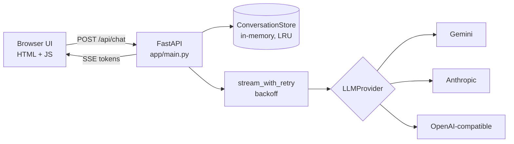

# AI Chatbot

A production-minded LLM chatbot: **FastAPI** backend, streaming UI, and a **provider-agnostic** core that runs on Google Gemini, Anthropic Claude, or any OpenAI-compatible API (OpenAI, Groq, OpenRouter, local Ollama), switched with one environment variable.

Built to be small enough to read in ten minutes and solid enough to build on: typed config, retries with backoff, context-window management, rate limiting, tests, Docker and CI.

<!-- Add a screenshot or GIF here:  -->

## Features

- **Streaming responses** over Server-Sent Events, rendered as sanitized Markdown with code-block copy buttons
- **Multi-turn memory:** server-side history per conversation, trimmed to a sliding window so cost and latency stay bounded
- **Swap LLMs without touching code:** `PROVIDER=gemini|anthropic|openai`
- **Resilient:** automatic retry with exponential backoff on 429/503 (only before any output is streamed, so replies are never duplicated), clear user-facing errors for bad keys, rate limits and empty responses
- **Stop generation:** cancelling mid-stream keeps the partial reply so history matches what the user saw
- **Session restore:** reload the page and the conversation is still there
- **Safe by default:** per-IP rate limiting, input validation, one in-flight reply per conversation, sanitized HTML output
- **Observability:** structured logs with model, latency and reply size; `/api/health` endpoint
- **Tested:** unit and API tests run against a fake provider, so no API key or network is needed

## Architecture



Each provider implements one small interface (`stream(messages, system, max_tokens) -> AsyncIterator[str]`) and translates vendor exceptions into a single `LLMError`. Everything above that line is vendor-neutral.

## Quick start

Requires Python 3.10+.

```bash
make install                  # creates .venv and installs dependencies
cp .env.example .env          # add your API key (free Gemini key: https://aistudio.google.com/apikey)
make run                      # http://localhost:8000
```

Without `make`:

```bash
python3 -m venv .venv && source .venv/bin/activate
pip install -r requirements-dev.txt
cp .env.example .env
uvicorn app.main:app --reload
```

### Docker

```bash
cp .env.example .env          # add your API key
docker compose up --build
```

## Configuration

All settings are environment variables (or `.env`). See [.env.example](.env.example).

| Variable | Default | Description |
|---|---|---|
| `PROVIDER` | `gemini` | `gemini`, `anthropic` or `openai` |
| `GEMINI_API_KEY` / `ANTHROPIC_API_KEY` / `OPENAI_API_KEY` | – | Key for the selected provider |
| `OPENAI_BASE_URL` | – | Point the `openai` provider at Groq, OpenRouter, Ollama, etc. |
| `MODEL` | per provider | Override the model ID |
| `SYSTEM_PROMPT` | friendly, concise assistant | Bot behavior |
| `MAX_TOKENS` | `2048` | Max reply length |
| `MAX_RETRIES` | `3` | Retries on transient errors (1s, 2s, 4s backoff) |
| `MAX_HISTORY_MESSAGES` | `40` | Sliding context window |
| `RATE_LIMIT_PER_MINUTE` | `30` | Per-IP request limit, `0` disables |

Examples:

```bash
PROVIDER=anthropic ANTHROPIC_API_KEY=... uvicorn app.main:app
PROVIDER=openai OPENAI_BASE_URL=https://api.groq.com/openai/v1 OPENAI_API_KEY=... MODEL=llama-3.3-70b-versatile uvicorn app.main:app
PROVIDER=openai OPENAI_BASE_URL=http://localhost:11434/v1 MODEL=llama3.2 uvicorn app.main:app   # local Ollama
```

Model IDs change often; if a provider rejects the default, set `MODEL` to a current one.

## API

| Endpoint | Description |
|---|---|
| `POST /api/chat` | Body `{message, conversation_id?}`. Streams SSE events: `start` (with `conversation_id`), `token`, `done`, `error` |
| `POST /api/reset/{id}` | Clear a conversation |
| `GET /api/history/{id}` | Stored messages |
| `GET /api/health` | Status, provider and model |

Interactive docs are served at `/docs`.

## Project structure

```
app/
  main.py            App factory, routes, SSE streaming, cancellation handling
  config.py          Typed settings (pydantic-settings)
  service.py         Retry with exponential backoff
  store.py           Conversation history, windowing, LRU eviction
  ratelimit.py       Sliding-window rate limiter
  providers/         base interface + Gemini, Anthropic, OpenAI-compatible
  static/            Chat UI (HTML, CSS, JS, no build step)
tests/               API and unit tests with a fake provider
```

## Development

```bash
make test      # pytest
make lint      # ruff check + format check
make format
```

CI (GitHub Actions) runs lint and tests on Python 3.10 and 3.12.

## Design decisions and trade-offs

- **SSE over WebSockets:** replies are one-directional streams; SSE is simpler, proxy-friendly and enough for chat.
- **Server-side history:** the client sends only the new message, so the server controls the context window and prompt, and clients can't tamper with history.
- **Retry only before first token:** retrying after partial output would duplicate or corrupt what the user already saw.
- **In-memory store:** keeps the prototype dependency-free. The `ConversationStore` interface is small so Redis or Postgres can replace it. Note the in-memory store and rate limiter are per-process.
- **No build step on the frontend:** vanilla JS keeps the project easy to read and deploy. Markdown libraries load from a CDN and the UI degrades to plain text if they're unavailable.

## Roadmap

- Persistent storage (Redis/Postgres) and multi-worker deployment
- Token-aware context trimming and summarization of long histories
- Authentication and per-user conversations
- Tool/function calling and retrieval (RAG)
- Usage and cost tracking
